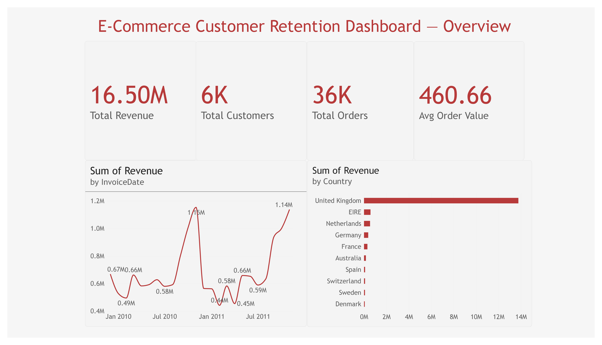
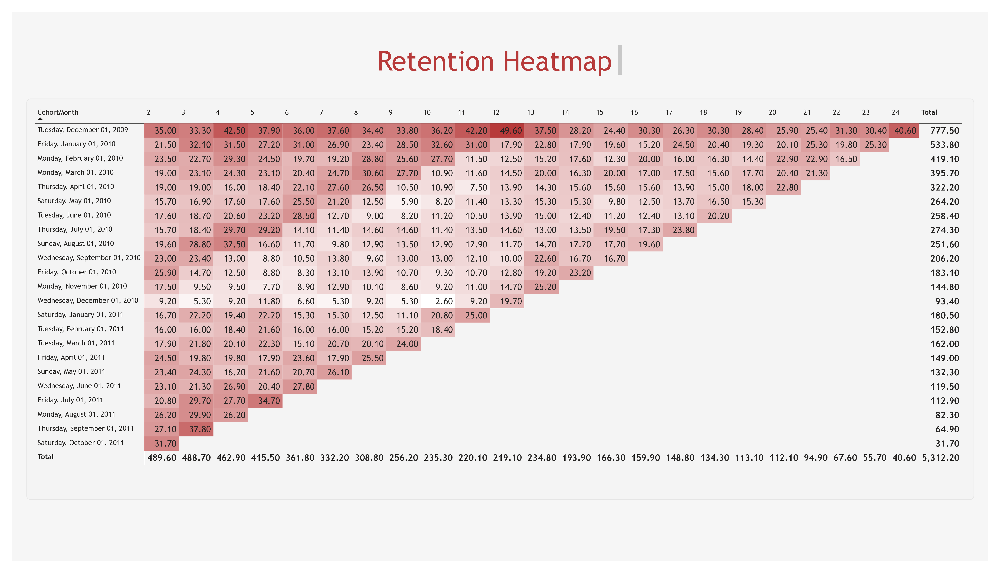
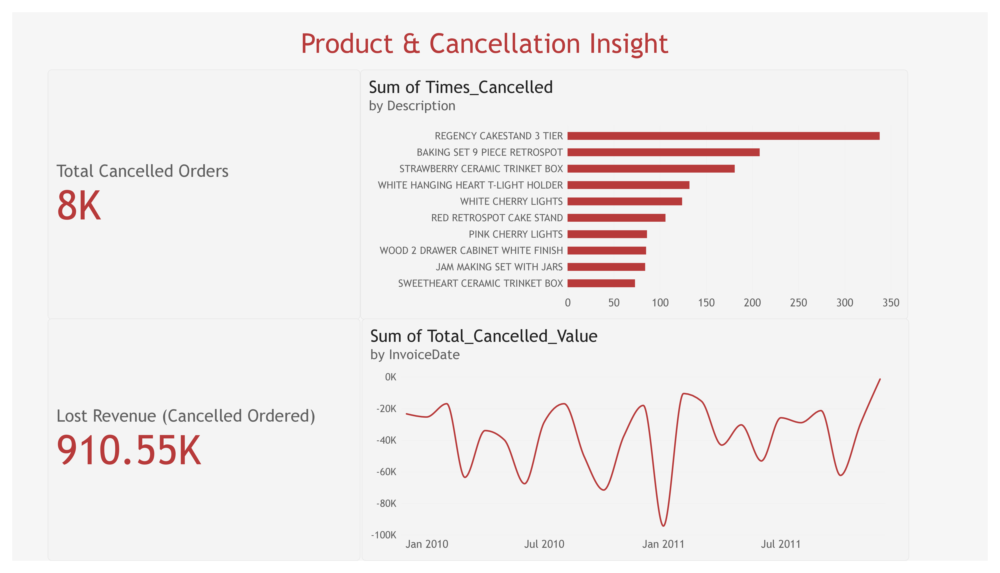

# E-Commerce Customer Retention & Cohort Analysis Dashboard

End-to-end analysis of customer retention and cohort behavior for an e-commerce
business using Python (Pandas) and Power BI — covering data cleaning, cohort
analysis, retention calculation, and an interactive 3-page dashboard.

## Dashboard Preview

### Overview


### Retention Heatmap


### Product & Cancellation Insight


## Workflow

1. Data Understanding
2. Data Cleaning
3. Revenue & Transaction Table
4. Customer Cohort
5. Retention Calculation
6. Exploratory Analysis
7. Power BI Dashboard
8. Business Insights

## Key Business Insights

| Finding | Number | Recommendation |
| --- | --- | --- |
| Sharp drop-off after first purchase | ~20–25% of customers return in month 2 | Focus retention campaigns in the 30–60 day window after first purchase |
| Strong seasonal pattern | Revenue peaks every Sep–Nov (gift/Christmas season) | Run pre-season re-engagement campaigns in August |
| Heavy dependence on UK market | 82.7% of revenue from United Kingdom | Prioritize UK retention; expand gradually to EIRE, Netherlands, Germany |
| Significant cancellation value | ~8K cancelled orders, ~910K lost revenue | Audit products with the highest cancellation rate |
| First cohort bias (Dec 2009) | Appears to retain better than other cohorts | Limitation: likely includes pre-existing customers, not pure new acquisitions |

## Data Limitations

- 13.5% of total revenue comes from transactions without an identified Customer ID (excluded from cohort analysis).
- December 2011 (only 4 days of data) was excluded from cohort calculations to keep a full 24-month window.

## Tools

- Python (Pandas) — Google Colab
- Power BI Desktop

## Repository Structure

```
notebooks/   # Analysis notebook (.ipynb)
data/        # Cleaned & aggregated CSV files
dashboard/   # Dashboard screenshots
```

## Dataset

[Online Retail II Dataset](https://archive.ics.uci.edu/dataset/502/online+retail+ii) (UCI Machine Learning Repository)
